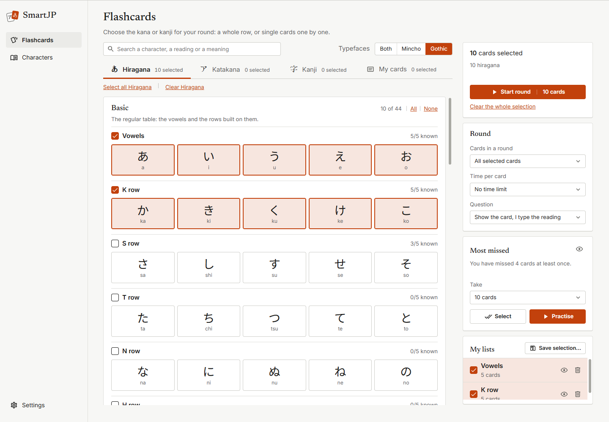
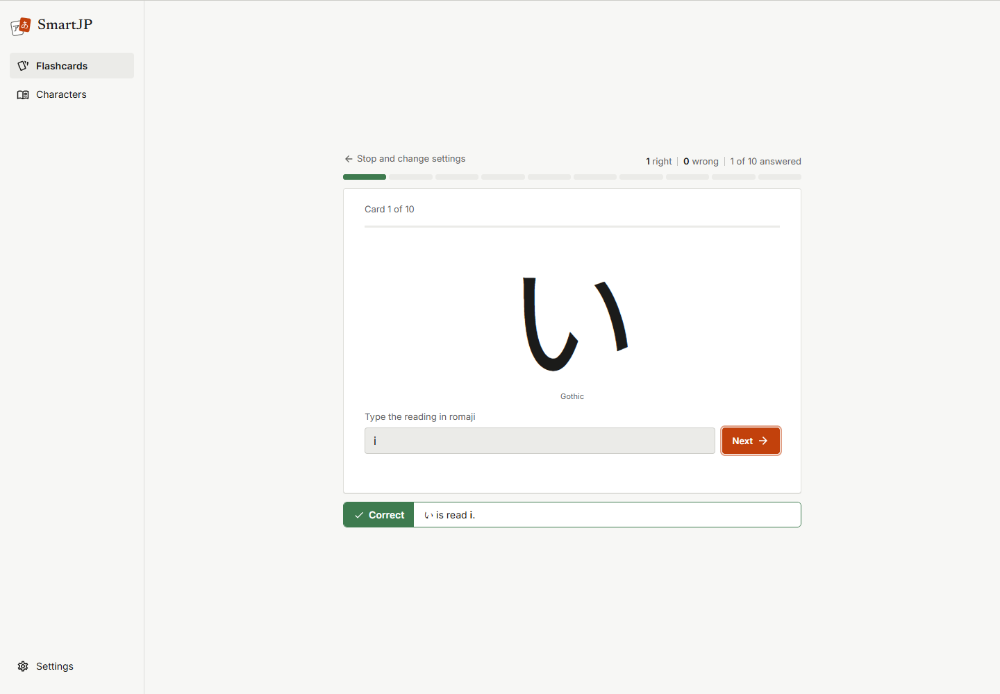
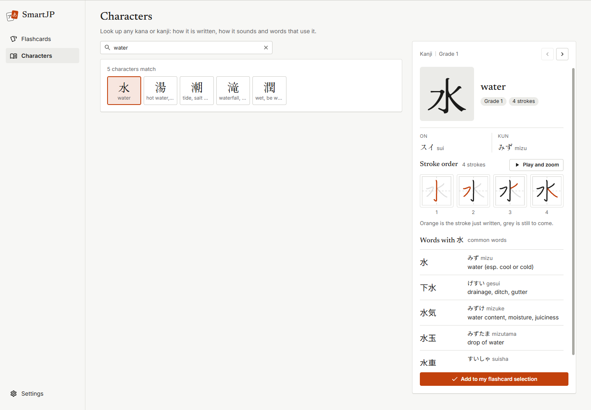
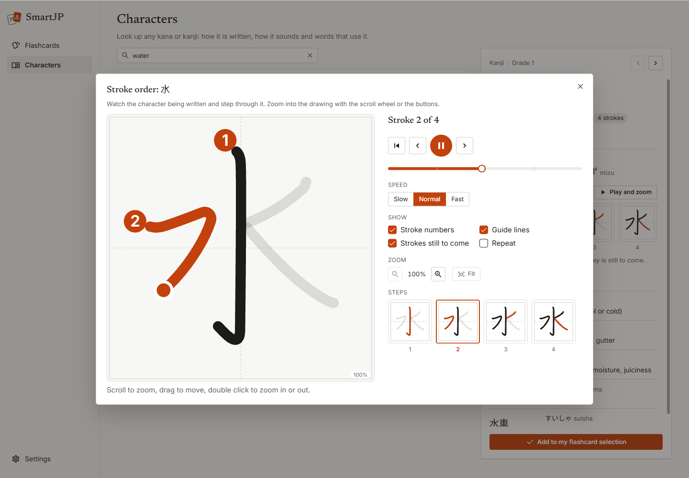
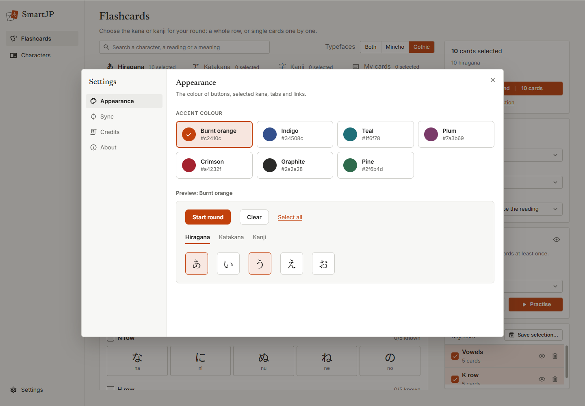

<h1 align="center">
  <br>
  SmartJP
</h1>

<p align="center">
  <b>Learn Japanese, kana first.</b><br>
  Hiragana | Katakana | 2136 jouyou kanji | Stroke order | Your own cards
</p>

<p align="center">
  
  
  <a href="https://github.com/B077AS/jolt"></a>
  
  
  
  
</p>

<p align="center">
  
</p>

---

## What is SmartJP?

SmartJP teaches Japanese **kana first** (hiragana and katakana), then the kanji by school grade. You practise with flashcards, look characters up on a reference page, and write your
own cards for anything else you want to remember.

There are no accounts and nothing to sign up for. Your progress is a **SQLite file** on your own machine, and everything the app needs (fonts, kanji, readings, stroke data, example words)
is bundled, so it works offline.

It is also a showcase for [Jolt](https://github.com/B077AS/jolt): **one Spring Boot application with a Vue front end that is both a desktop app and a website.** One jar, two ways to start it,
and the same code behind both:

- **Desktop app**: the application in a native window (WebView2 on Windows, WebKitGTK on Linux), with no web server and no open port. It installs with a normal installer and updates itself.
- **Website**: you host it yourself, as a Docker image. Nobody else's server is involved. If you want your progress on two machines, run the website and **sync** the desktop app with it.

## Features

**Flashcards**
- Hiragana and katakana (the basic table, voiced and p-sounds, combinations) and all **2136 jouyou kanji** (grades 1 to 6 and 8)
- Pick single cards, a row, a section or a whole script, or search by character, by reading (kana or romaji) or by English meaning
- Three questions: show the card and type the reading, show the reading and type the kana, or show a kanji and type its meaning; plus "show the card, I check myself" for any card
- Choose the size of a round and an optional time per card; draw the kana in Hina Mincho, Noto Sans JP or both
- Every answer is kept: the **Most missed** panel lists the cards you get wrong and starts a round of exactly those
- **Saved lists** of cards, and **your own cards** (any text on the front, any text as the answer)

<p align="center">
  
</p>

**Characters**
- The traditional kana chart, and every kanji by grade
- For each character: its readings with romaji, its meanings, its grade and stroke count, common example words, and its **stroke order** frame by frame
- A stroke player you can play, pause, step through and slow down, with zoom up to 600%, stroke numbers, guide lines and a pen dot at the tip of the stroke being drawn

<p align="center">
  
</p>

<p align="center">
  
</p>

**Your data**
- Saved lists, your own cards and every answer live in one SQLite file; the website and the desktop app run the same code on it
- **Sync** a desktop app with your own copy of the website: merge them (nothing is lost) or make one side a copy of the other, with a backup first
- The accent colour is yours too: seven to choose from

<p align="center">
  
</p>

## Install

### Desktop app

| | Download | Notes |
|---|---|---|
| **Windows 10/11** | `SmartJP-Setup.exe` from the [latest release](https://github.com/B077AS/smartjp/releases/latest) | Installs for your user only (no administrator rights). Uninstall it from Settings, Apps. |
| **Linux** (x86-64) | `SmartJP.AppImage` from the [latest release](https://github.com/B077AS/smartjp/releases/latest) | `chmod +x SmartJP.AppImage`, then run it. Needs GTK 3 and WebKitGTK 4.1: `sudo apt install libgtk-3-0 libwebkit2gtk-4.1-0` (and, to keep a sync key, a running keyring: `libsecret-1-0`). |

Both bring their own Java runtime, so nothing else has to be installed. When you start the app, a small launcher window checks GitHub for a newer version, downloads
only what changed and then opens the app; if GitHub cannot be reached it just starts the version you have. The installer, the AppImage and the updates all come from the
GitHub releases of this repository.

Your data lives outside the installation, so updating or uninstalling never touches it: `%LOCALAPPDATA%\smartjp\` on Windows, `$XDG_DATA_HOME/smartjp` or
`~/.local/share/smartjp` on Linux. Settings, About shows the version you run.

### Website (Docker)

The website is shipped only as a Docker image: `ghcr.io/b077as/smartjp` (`linux/amd64` and `linux/arm64`).

```bash
curl -LO https://raw.githubusercontent.com/B077AS/smartjp/master/docker/docker-compose.yml
docker compose up -d
docker compose logs          # the access key is printed here
```

Then open http://localhost:8081 and enter the key. The compose file publishes the port on `127.0.0.1` only, so nothing outside the machine can reach the site.

- **The access key.** There are no accounts: one random key (256 bits) is made at the first start. It unlocks the site in a browser and pairs a desktop app with it. It is
  printed in the log at every start and shown in Settings, Sync once you are in. To choose your own (at least 20 characters), set `SMARTJP_ACCESS_KEY`.
- **HTTPS.** Before reaching the site from anywhere but the machine it runs on, put HTTPS in front of it (a reverse proxy, or a VPN such as Tailscale) and change the
  published port in the compose file. The site does not do TLS itself. Behind a reverse proxy on a private address, `X-Forwarded-*` headers are trusted, so the
  cookie of the key is marked `Secure`.
- **Update:** `docker compose pull && docker compose up -d`. To stay on a version, use its tag (`ghcr.io/b077as/smartjp:0.1.0`) instead of `latest`.
- **Your data** is the `smartjp-data` volume (`/data`: the database `smartjp.db` and `logs/`). Back it up; replacing the image never touches it.

| Environment variable | Meaning |
|---|---|
| `SMARTJP_ACCESS_KEY` | A key of your own instead of the generated one (at least 20 characters; then it cannot be renewed in the app) |
| `SMARTJP_DATA_DIR` | The data folder (the image sets `/data`) |
| `SERVER_ADDRESS` | The address the site listens on (the image sets `0.0.0.0`; outside a container the default is `127.0.0.1`) |
| `SERVER_PORT` | The port (default `8081`) |

## Sync between the desktop app and your website

The desktop app and your own copy of the website are two peers, each with its own SQLite file. In the desktop app open Settings, Sync, enter the website's address and its
access key once, and choose:

- **Merge** (the default): adds what each side is missing. Answers are an append-only log; lists and your own cards take the newer version; deletions are remembered. Nothing is lost.
- **Replace this desktop with the server** or **Replace the server with this desktop**: one side becomes a copy of the other, after a confirmation. The side that is overwritten saves a backup file first.

The access key of the server is kept in the operating system's keystore (Windows Credential Manager, the Linux Secret Service), never in the database. The accent colour is a
taste of each device and is deliberately not synced.

## Develop

Needs JDK 25, Maven 3.9+ and Node 20+.

```
mvn test                                                # the tests (they run on a real SQLite file in a temp folder, no Node needed)
mvn -DskipTests package                                 # builds the Vue app too and packs it into the jar (-DskipFrontend leaves it out)
java -jar target/smartjp-0.1.0-SNAPSHOT.jar             # website, http://localhost:8081, data in ./data
java -jar target/smartjp-0.1.0-SNAPSHOT.jar --desktop   # desktop window, data in %LOCALAPPDATA%\smartjp
```

The front end is always part of the jar, so a published jar needs no flag besides `--desktop`. When you run the class from an IDE, build the pages first
(`cd frontend && npm install && npm run build`; it writes into `src/main/resources/static`) and restart after every front end change. The two IntelliJ configurations need
only the program argument `--desktop` (or none for the website).

Jolt and the SQLite driver both call native code, and Java warns about that unless told otherwise. The jar carries the setting in its manifest
(`Enable-Native-Access: ALL-UNNAMED`), so `java -jar` prints no warning. When you run the class from IntelliJ the manifest is not used:
add `--enable-native-access=ALL-UNNAMED` to the **VM options** (a VM option, unlike `--desktop`).

Front end only, with hot reload in a browser: start the website (above), then `cd frontend && npm install && npm run dev`
(http://localhost:5173, forwards `/api` to the website on 8081).

### Build the installable desktop app and the Docker image

```
cd launcher && mvn clean package && cd ..            # the launcher jar (launcher/target/smartjp-launcher.jar)
mvn clean package -Pjpack -DskipTests                # the install folder in target/jpack/image/<platform>/ and the update files in target/jpack/release/
target/jpack/image/windows-x64/SmartJP.exe           # run the installed app from that folder (Windows)
docker build -f docker/Dockerfile -t smartjp .       # the website image, around target/smartjp-*.jar
```

`-Pjpack` builds for the machine it runs on (a Windows machine builds the Windows install folder; the AppImage is built on Linux with `appimagetool`), with
[jpack](https://github.com/B077AS/jpack). The launcher can be previewed without an installation: `mvn -f launcher/pom.xml compile exec:exec -Dlauncher.demo=true`.
The Windows installer is an [Inno Setup](https://jrsoftware.org/isinfo.php) script in `packaging/windows/`. The GitHub Action in `.github/workflows/` builds all of it from a release tag.

## Where the data is

One file, `smartjp.db`:

| Started as | Folder |
|---|---|
| website (Docker) | `/data` in the container, the `smartjp-data` volume |
| website (`java -jar`) | `data/` next to where you started it |
| desktop (Windows) | `%LOCALAPPDATA%\smartjp\` |
| desktop (Linux) | `$XDG_DATA_HOME/smartjp` or `~/.local/share/smartjp` |

Set the property `smartjp.data-dir` or the environment variable `SMARTJP_DATA_DIR` to put it somewhere else. The database is accessed through JPA
(Hibernate), which creates the tables and adds missing columns when the application starts (`ddl-auto=update`, no SQL scripts). To back it up or move it, copy the file
while the application is not running. The logs are in `logs/` inside the same folder.

## The API (website only; JSON)

The desktop app calls the same Java services through Jolt (`lists.all`, `answers.record`, `sync.run` and so on) instead of HTTP. Everything under `/api` except `/api/session`
needs the access key (the header `X-SmartJP-Key`, or the cookie the unlock page sets).

| Path | What |
|---|---|
| `/api/lists` | the saved flashcard lists (`GET`, `POST`, `DELETE /{id}`) |
| `/api/custom-cards` | your own cards (`GET`, `POST`, `DELETE /{id}`) |
| `/api/answers` | the answer log (`GET /stats`, `POST`) |
| `/api/appearance` | the accent colour (`GET`, `POST`) |
| `/api/app` | the version, the system and how it runs (`GET`) |
| `/api/sync/...` | `summary`, `snapshot`, `merge`, `replace`, `key`, `key/renew` |
| `/api/session` | trades a typed key for the cookie |

A save is accepted only as `application/json`, and always answers `200` with a `result` word (for a list: `created`, `replaced`, `empty_name`, `no_cards`, `bad_cards` or `too_many`).

## Security measures

No accounts, passwords or sessions to leak. The one access key protects `/api`, is compared in constant time and is stored only as a hash in the cookie. A save is only accepted from
a `application/json` request (a page on another site cannot send that without the browser asking first, and this server never says yes). Every answer carries a strict
Content-Security-Policy, `X-Frame-Options: DENY` and the usual headers; answers under `/api` are never cached. The desktop app opens no port at all, and the Docker image runs as
a non-root user.

## License

The code of SmartJP is released under the [MIT License](LICENSE). Some of what ships with it is not mine and keeps its own license:

| What | Where it is used | License |
|---|---|---|
| **KANJIDIC2** (the kanji, their grades, readings and meanings) and **JMdict** (the example words), by the [EDRDG](https://www.edrdg.org/edrdg/licence.html) | `frontend/src/kanji/kanji-data.json`, `frontend/src/words/words-data.json` | [CC BY-SA 4.0](https://creativecommons.org/licenses/by-sa/4.0/) |
| **KanjiVG** (stroke order), by Ulrich Apel and contributors, [kanjivg.tagaini.net](https://kanjivg.tagaini.net) | `frontend/src/strokes/stroke-data.json` | [CC BY-SA 3.0](https://creativecommons.org/licenses/by-sa/3.0/) |
| **Hina Mincho**, **Noto Sans JP**, **Inter** and **Newsreader** (the typefaces) | bundled with the app through `@fontsource` | [SIL Open Font License 1.1](https://openfontlicense.org/) |
| **Material Design Icons** (the icons in the interface) | `@mdi/js` | Apache-2.0 |

The three data files are built from those sources by the scripts in `frontend/tools/` and are **not** covered by the MIT license: they stay under their share-alike
licenses, and the credits are shown in the app under Settings, Credits. The license text of each typeface, with its copyright notice, is in
[`frontend/public/licenses/`](frontend/public/licenses) and is shipped with the app. The other libraries (Spring Boot, [Jolt](https://github.com/B077AS/jolt), [jpack](https://github.com/B077AS/jpack), Vue,
Reka UI, WanaKana and the rest) keep their own licenses.
